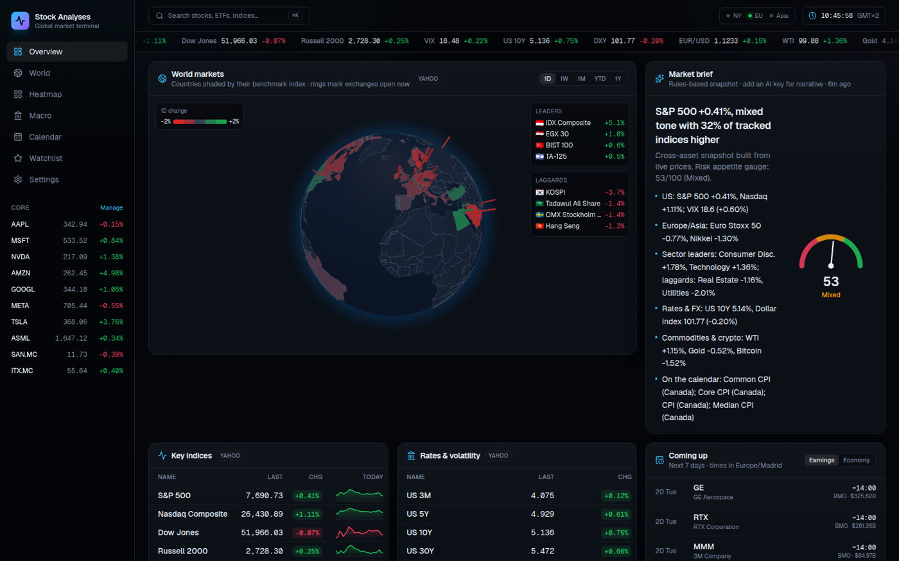
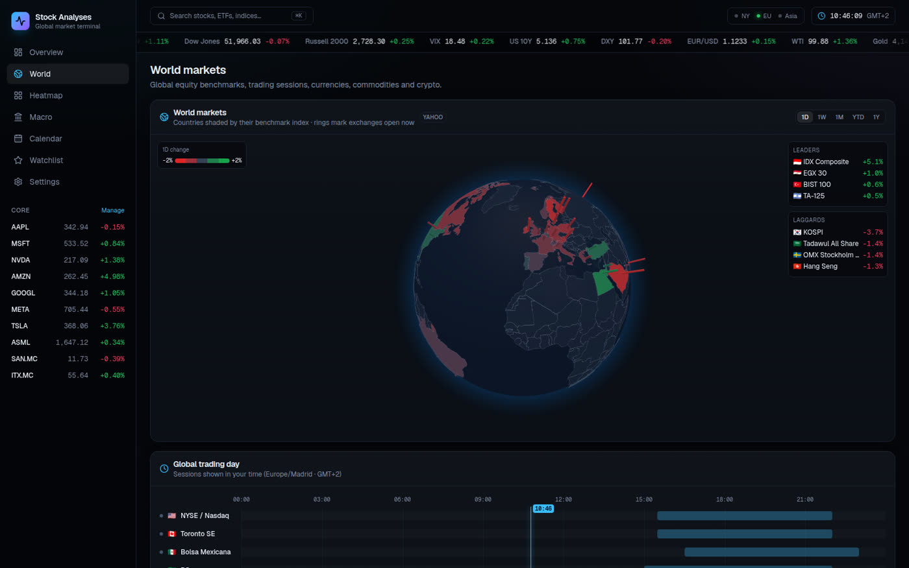
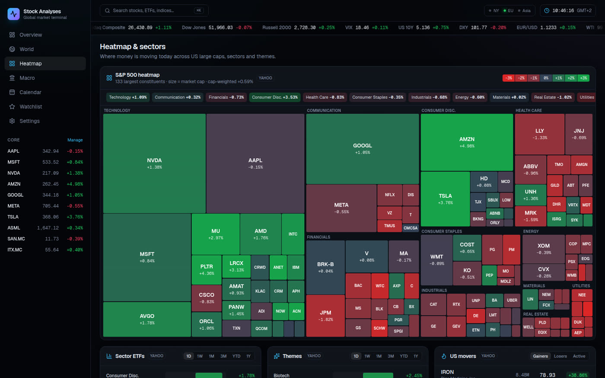
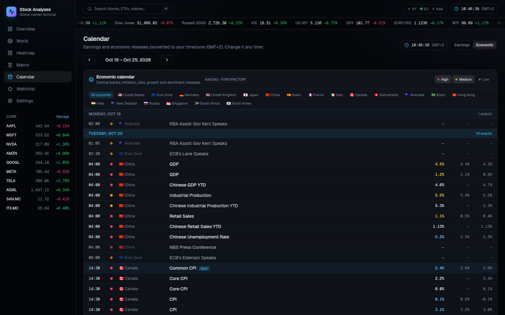
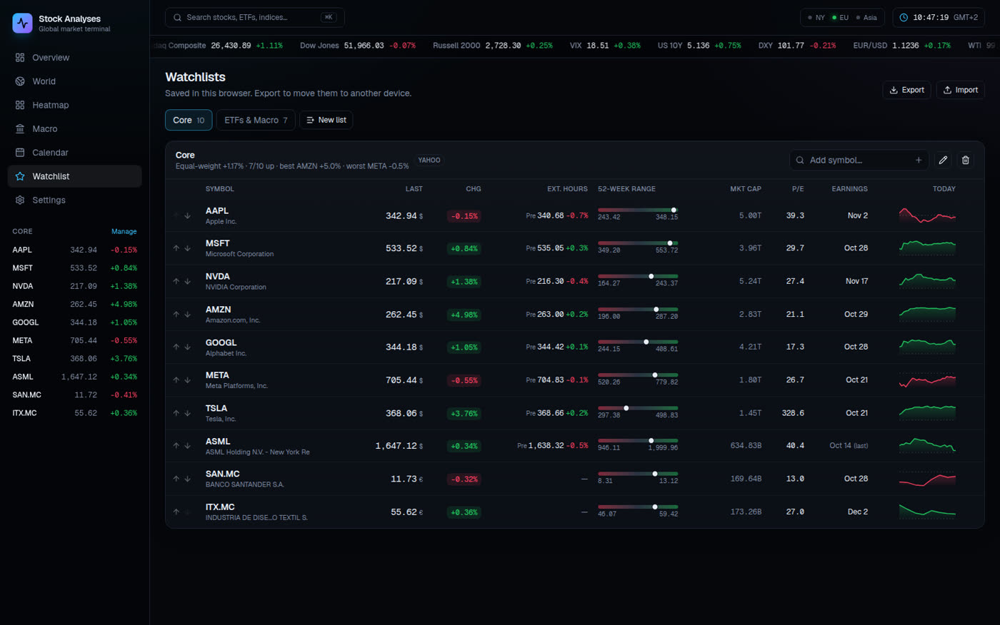
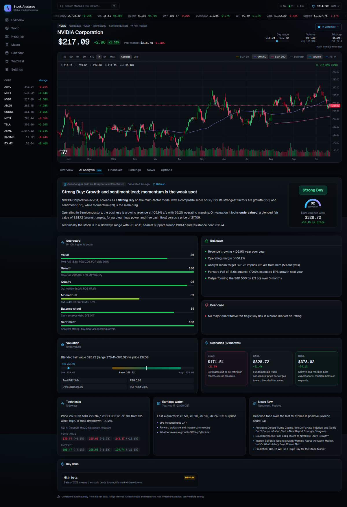
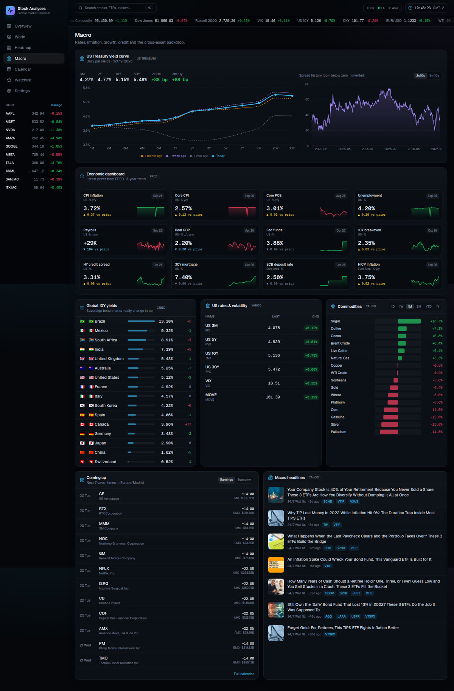
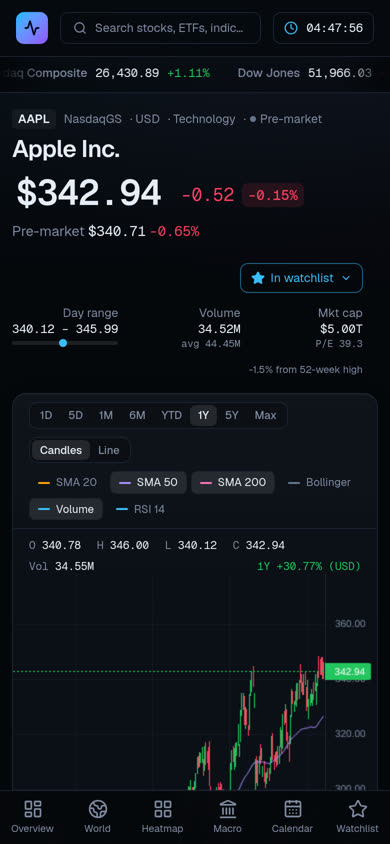

# Stock Analyses: Global Market Terminal

A daily-driver dashboard for global markets, covering the macro picture across countries, rates, FX, commodities and crypto, plus deep dives on individual stocks with AI analysis. It runs with **zero API keys** on keyless public data sources. Optional keys add an LLM-written thesis and backup data providers.



<details>
<summary>More screenshots</summary>

| World markets                                          | Heatmap                                      |
| ------------------------------------------------------ | -------------------------------------------- |
|    |      |
| **Economic calendar**                                  | **Watchlist**                                |
|     |  |
| **Stock page with AI analysis**                        | **Macro**                                    |
|  |          |



</details>

## Features

| Area              | What you get                                                                                                                                                                                                                                                                     |
| ----------------- | -------------------------------------------------------------------------------------------------------------------------------------------------------------------------------------------------------------------------------------------------------------------------------- |
| **Overview**      | 3D globe of country benchmark performance (1D/1W/1M/YTD/1Y), market brief with a risk-on/off gauge, key indices, rates and VIX, the coming week's earnings and macro events, S&P 500 heatmap, sector bars, FX, commodities, movers, headlines and live exchange status           |
| **World markets** | Globe, a 24-hour trading-day timeline of 23 exchanges in _your_ time zone (lunch breaks and Sun–Thu venues included), 47 indices by region with 1W/1M/YTD/1Y returns, FX, commodities and crypto                                                                                 |
| **Heatmap**       | Squarified treemap of about 130 S&P 500 large caps sized by market cap; sector, theme and US-mover leaderboards                                                                                                                                                                  |
| **Macro**         | US Treasury yield curve vs 1W/1M/1Y ago, 2s10s and 3m10y spread history, 12 FRED indicators (CPI, core PCE, payrolls, GDP, Fed funds, HY spreads, ECB rate, euro HICP…), 16 sovereign 10Y yields, commodities and macro news                                                     |
| **Calendar**      | Earnings by day with BMO/AMC converted to local time, plus large-cap, watchlist and ticker filters. The economic calendar shows impact levels, country filters and actual vs forecast. The time zone is auto-detected and can be overridden.                                     |
| **Stock pages**   | Live quote (15 s polling, pre- and post-market), candlestick or line chart with SMA 20/50/200, Bollinger bands, volume and an RSI pane, and tabs for **AI Analysis**, key stats, analyst targets and ratings, financials, earnings (EPS vs estimate), news and the options chain |
| **AI analysis**   | Rating, conviction, thesis, bull and bear cases, valuation with a fair-value range, 12-month scenarios, technical levels, risks with severity, an earnings watch-list and news sentiment, all scored against a six-factor quant scorecard                                        |
| **Watchlists**    | Multiple lists in `localStorage` with reorder, live table (extended hours, 52-week range, next earnings) and JSON import and export                                                                                                                                              |
| **Everywhere**    | ⌘K / `/` command palette, scrolling ticker tape, market-status pill, "Demo data" badges when a source falls back, and skeleton, empty and error states                                                                                                                           |

## Architecture

```
Next.js 16 (App Router, React 19, Tailwind v4, Cache Components)
├─ src/app/(pages)          Server-rendered shells; data widgets are client components (TanStack Query polling)
├─ src/app/api/**           Route handlers = the only place that talks to upstream APIs
│   └─ src/lib/server/*     Data adapters + in-memory SWR cache with in-flight de-duplication
│       ├─ yahoo.ts         Quotes, charts, spark, quoteSummary, fundamentals timeseries, search, news, screener, options
│       ├─ calendars.ts     Nasdaq earnings + economic calendar (impact enriched from ForexFactory)
│       ├─ macro.ts         US Treasury curve, CNBC sovereign yields, FRED, CoinGecko
│       ├─ analysis.ts      Quant engine (technicals, 6-factor scorecard, fair value) + LLM prompt/schema
│       ├─ brief.ts         Cross-asset market brief (LLM or rules-based)
│       └─ mock.ts          Deterministic demo data used only when a live source fails
└─ src/components/**        Globe (react-globe.gl/three), charts (lightweight-charts, recharts), treemap (d3-hierarchy)
```

- **Resilience.** Every API route returns `{ data, meta: { source, asOf, stale, note } }`. The cache serves stale data while it revalidates. If an upstream source fails, routes with a fallback serve mock data with `source: "mock"`, and the UI shows a "Demo data" badge. Unknown tickers return 404 instead of fake data.
- **Yahoo access.** Yahoo rate-limits (HTTP 429) generic HTTP clients from cloud IPs, which is likely why the old Cloud Run deploy broke. Requests go through [`impit`](https://github.com/apify/impit), a Rust HTTP client with a Chrome TLS fingerprint, plus Yahoo's cookie and crumb handshake. impit is loaded lazily. If its native binary cannot load, the app falls back to plain `fetch`, then Finnhub (an optional backup for quotes, news and earnings), then labelled demo data. impit has been verified in a real `vercel build` output running on the AWS Lambda Node 24 / Amazon Linux 2023 image.
- **AI.** OpenRouter's free models are the default, and any OpenAI-compatible API (Gemini, Groq, OpenAI or a custom endpoint) can join the chain. The model receives a compact data packet (profile, about 40 stats, analyst data, earnings history, computed technicals, the quant scorecard and headlines), must return JSON in a fixed schema, and is validated with zod. Models are tried in order. A model that is rate-limited, retired or returns invalid JSON is paused for between 1 minute and 6 hours depending on the error. When OpenRouter's daily free cap is hit, every `:free` model pauses until the reset. When the whole chain is exhausted, the deterministic quant engine fills the same schema. AI results are cached for 6 h, quant fallbacks for only 15 min, and manual refresh is rate-limited per symbol. Settings shows the live chain and any paused models.
- **Time zones.** All instants travel as UTC ISO strings and are formatted in the browser's zone or the user's override. Exchange sessions are computed from IANA zones, so DST is handled. BMO/AMC earnings are approximated as 08:00 and 16:05 ET. Stock pages show Yahoo's exact timestamp when one is available.

## Data sources

| Source                     | Used for                                                  | Key                            |
| -------------------------- | --------------------------------------------------------- | ------------------------------ |
| Yahoo Finance (unofficial) | Quotes, charts, fundamentals, analyst data, news, options | none                           |
| Nasdaq.com calendars       | Earnings and economic calendar                            | none                           |
| ForexFactory weekly JSON   | Economic event impact levels                              | none                           |
| US Treasury                | Daily par yield curve                                     | none                           |
| FRED (St. Louis Fed)       | Macro indicators                                          | optional (`FRED_API_KEY`)      |
| CNBC quote API             | Global 10Y sovereign yields                               | none                           |
| CoinGecko                  | Crypto markets                                            | optional (`COINGECKO_API_KEY`) |
| Finnhub                    | Backup quotes, company news, earnings                     | optional (`FINNHUB_API_KEY`)   |

Data may be delayed and the unofficial endpoints can change without notice. The app is for information only and is not investment advice.

## Environment variables

Copy `.env.example` to `.env.local`. **All variables are optional.**

| Variable                     | Purpose                                                                                                  | Free tier                                                                                                     |
| ---------------------------- | -------------------------------------------------------------------------------------------------------- | ------------------------------------------------------------------------------------------------------------- |
| `OPENROUTER_API_KEY`         | AI analysis and brief through OpenRouter's free models (default provider)                                | [openrouter.ai/keys](https://openrouter.ai/keys): 50 free requests/day, 1,000/day after a one-time $10 top-up |
| `AI_MODEL`                   | Preferred model(s), comma-separated, tried first                                                         |                                                                                                               |
| `AI_FALLBACK_MODELS`         | Replaces the built-in free fallback list                                                                 |                                                                                                               |
| `AI_PROVIDER`                | Primary provider when several keys are set (`openrouter`, `gemini`, `groq`, `custom`, `openai`)          |                                                                                                               |
| `GEMINI_API_KEY`             | Google Gemini (`gemini-flash-latest`)                                                                    | [Google AI Studio](https://aistudio.google.com/apikey)                                                        |
| `GROQ_API_KEY`               | Groq (`openai/gpt-oss-120b`, `llama-3.3-70b-versatile`)                                                  | [Groq console](https://console.groq.com/keys)                                                                 |
| `OPENAI_API_KEY`             | OpenAI (`gpt-5-mini`)                                                                                    | paid                                                                                                          |
| `AI_API_KEY` + `AI_BASE_URL` | Any other OpenAI-compatible endpoint, with models from `AI_MODEL`                                        |                                                                                                               |
| `FINNHUB_API_KEY`            | Backup market data                                                                                       | [finnhub.io/register](https://finnhub.io/register)                                                            |
| `FRED_API_KEY`               | Higher FRED limits                                                                                       | [FRED API keys](https://fredaccount.stlouisfed.org/apikeys)                                                   |
| `COINGECKO_API_KEY`          | Higher CoinGecko limits                                                                                  | [CoinGecko demo key](https://www.coingecko.com/en/developers/dashboard)                                       |
| `SITE_URL`                   | Canonical URL for metadata, robots.txt and the www → apex redirect (default `https://stockanalyses.org`) |                                                                                                               |
| `HTTP_CLIENT`                | `fetch` disables impit                                                                                   |                                                                                                               |

**Default free model chain (OpenRouter, October 2026):**

1. `minimax/minimax-m3.1-flash:free`
2. `nvidia/nemotron-3.5-super-vl:free`
3. `thinkingmachines/inkling:free`
4. `google/gemma-4-31b-it:free`
5. `nvidia/nemotron-3-super-120b-a12b:free`
6. `openrouter/free` (OpenRouter's router across whatever free models exist)

Every other configured provider is appended after these, and the quant engine comes last.

**OpenCode Zen.** Zen's API is OpenAI-compatible, but its free models (such as `mimo-v2.6-flash-free`) answer only requests coming from the OpenCode app. Requests from other apps get `FreeTierError`. Its paid models work with `AI_API_KEY`, `AI_BASE_URL=https://opencode.ai/zen/v1` and `AI_MODEL=<model>`. On OpenRouter, Xiaomi MiMo is currently a paid model (`xiaomi/mimo-v2.6-flash`, about $0.14 per million input tokens).

## Run locally

```bash
npm install
cp .env.example .env.local   # optional
npm run dev                  # http://localhost:3000
```

Other scripts: `npm run lint`, `npm run typecheck`, `npm run format`, `npm run build && npm start`.

Requires Node 20.9+. On Linux x64 and macOS, `impit` installs a prebuilt native binary automatically.

## Deploy

### Recommended: Vercel Hobby (free) at stockanalyses.org

**Step-by-step guide: [`docs/DEPLOY.md`](docs/DEPLOY.md).** It covers the Vercel import, environment variables, adding the domain, the Cloudflare DNS records, proxy and SSL settings, and verification.

In short:

1. Import the repo at [vercel.com/new](https://vercel.com/new).
2. Add `OPENROUTER_API_KEY` and `SITE_URL=https://stockanalyses.org`, then deploy.
3. Add `stockanalyses.org` in Vercel, with `www` redirecting to the apex.
4. In Cloudflare, create the `A @` and `CNAME www` records Vercel shows, both set to **DNS only** (grey cloud), and set the SSL mode to **Full (strict)**.

`vercel.json` pins functions to `iad1` (US East) and enables Fluid compute. Yahoo can answer EU IP addresses with a GDPR consent wall that breaks its cookie and crumb handshake, and most of the upstream APIs are in the US anyway. Hobby is free for personal, non-commercial use and needs no credit card.

### Alternative: Google Cloud Run (container)

The repo has a production `Dockerfile` (Next.js standalone output, port 8080) and a **manual** workflow at `.github/workflows/deploy-cloud-run.yml`. To use it, run **Actions → Deploy to Cloud Run → Run workflow**. It reuses the existing `GCP_PROJECT_ID` and `GCP_SA_KEY` secrets and deploys with scale-to-zero and a single instance, which stays inside the free tier for personal use. The default region is `us-central1` for the same Yahoo reason.

```bash
gcloud run deploy stock-analysis-tool --source . --region us-central1 --allow-unauthenticated --port 8080 --min-instances 0 --max-instances 1
gcloud run services update stock-analysis-tool --region us-central1 --update-env-vars GEMINI_API_KEY=...   # optional
```

The container also runs unchanged on Railway, Render or Fly.io (`docker build -t market-terminal . && docker run -p 8080:8080 market-terminal`).

## CI

`.github/workflows/ci.yml` runs lint, typecheck, Prettier and `next build` on every PR and push, and builds the Docker image without pushing it. Nothing deploys automatically.
